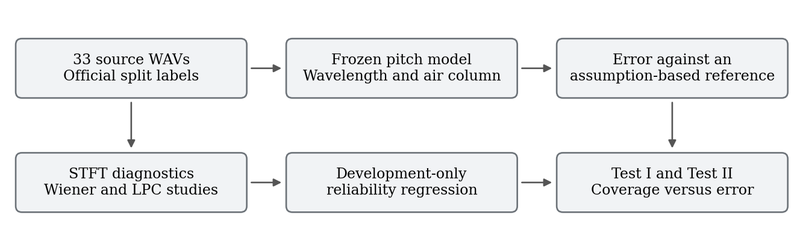
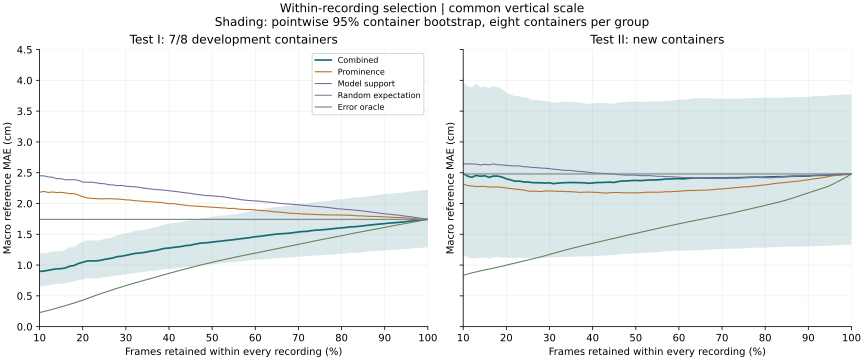

# Pouring-Sound Reliability

Acoustic diagnostics for physical estimates from pouring sounds.

**[Project website](https://lyu-ui.github.io/elec5305-project-540568813/)** ·
[Methods](docs/METHODS.md) · [Results](docs/RESULTS.md) ·
[Reproduce the experiments](docs/REPRODUCIBILITY.md)

**Question:** can acoustic evidence identify when a pretrained model's
air-column estimate is unreliable?

This project evaluates a frozen [Sound of Water](https://github.com/bpiyush/SoundOfWater)
model on 33 recordings from 25 containers. It combines spectral diagnostics,
a development-only reliability model, recording-held-out selective prediction, and
focused Wiener/LPC controls. The MATLAB experiment helpers have been run and
checked against an independent Python implementation.

**Scope:** errors are measured against an assumption-derived filling curve.
There are no independently measured liquid-level trajectories in this project.
Results therefore describe agreement with that reference, not validated
liquid-level accuracy. The extension also includes explicitly provisional,
AI-assisted image-relative references. The author has confirmed all 46 green
water-surface bands; these are not calibrated measurements.

## Extended experiments

- **160 model conditions:** 16 clean controls and 144 noisy runs across all test
  recordings, with the network and reliability score frozen. At 0 dB, the score
  still retains many high-error frames.
- **33-recording endpoint comparison:** a fixed terminal median repairs two
  severe global offsets but worsens several other recordings. Every case is retained.
- **72 video time points screened:** 46 provisional visual labels and 26 documented
  exclusions. The project author has confirmed all 46 displayed green water-surface
  bands. Independent blinded review, rim/base confirmation and calibrated physical
  validation remain open.

[Extension methods, findings and reproduction](docs/EXPERIMENT_EXTENSION.md) ·
[Per-recording results](experiments/results/)



## Main findings

**Split correction:** official Test I holds out recordings, but 7 of its 8
containers also occur in reliability-score development (1, 6, 7, 18, 25, 30,
31). Only clip_18/container_40 is new to that score. Test II holds out containers
from both score development and upstream neural-model training. Machine-readable
`seen_test`/`unseen_test` identifiers retain their original official split meaning.

| Evaluation group | Full MAE | MAE at 70% | Paired change, 95% bootstrap interval | Exact two-sided p |
| --- | ---: | ---: | --- | ---: |
| Test I: 7/8 development containers | 1.742 cm | 1.538 cm | -0.204 [-0.274, -0.134] cm | 0.0078 |
| Test II: new containers | 2.479 cm | 2.414 cm | -0.065 [-0.158, +0.031] cm | 0.26 |

These equal-recording results use the fixed Combined score. Exact tests enumerate
all 256 container sign assignments; eight-cluster bootstrap intervals remain
uncertain. Prominence worsens 7/8 Test I recordings but has a lower observed
Test II mean driven mainly by two clips (p=0.45 versus no selection).
Its effect is unstable across groups; superiority is not established.

A new 11-container leave-one-container-out evaluation pools development and
Test I (19 recordings), withholding all recordings of each outer container.
Fixed ridge 0.1 changes equal-container reference MAE from 1.457 to 1.329 cm;
nested training-only ridge selection gives 1.331 cm. This is a post-review
analysis within that domain, not a replacement for Test II.



Global threshold curves reveal another limit: Combined AURC is 1.293 cm for
Test I but 2.738 cm for Test II, against constant-risk areas of 1.742/2.479 cm.
On new containers a global score threshold is worse than no selection. A
recording-level endpoint-jump diagnostic flags clips 24 and 26, but its ranking
also fails on other cases. [Full audit, exact tests, folds and AURC definitions](docs/STATISTICAL_AUDIT.md).

## Quick start

### Prepare the inputs once

Download or clone the project. In a terminal at the project root, use Python
3.12 or 3.13 (both checked in CI) and the pinned analysis dependencies:

```bash
python3 -m venv .venv
source .venv/bin/activate
python -m pip install -r python/requirements-analysis.txt
python python/setup_project.py --portable
```

On Windows, use `.venv\Scripts\activate` for activation. The setup script
fetches the 33 recordings directly from the original public dataset, verifies
every source hash exactly, resamples them to 16 kHz, and recreates the fixed control inputs,
listening examples and local frame tables. Portable mode compares 12 archived
summary tables numerically (atol 1e-7, rtol 1e-9), validates both generated frame
tables, and preserves published summaries and figures. Omit `--portable` for
the original strict 14-file byte-hash check. Resampled float32 WAV bytes can
differ by CPU architecture (3 of 33 on Apple Silicon), so portable mode checks
those files by format and length, reports them in
`outputs/verification/analysis_wav_portability.json`, and relies on the numeric
table comparison. Internet access is required for this preparation; no
neural-network checkpoint is downloaded.

### Run MATLAB

Select the project root as MATLAB Current Folder, then run:

```matlab
R = run_project;
```

This recomputes the analysis, checks it against the prepared Python reference
tables, and writes the complete MATLAB figures and CSVs to `outputs/matlab/`
(ignored by git). Archived evidence in `matlab_results/` is never overwritten.
After setup this route runs offline. For listening:

```matlab
R = run_project(true);
```

For a numerical run without opening figure windows:

```matlab
R = run_project(false, false);
```

The entry point was executed in **MATLAB R2025b Update 7**, base MATLAB,
in [GitHub CI on 9 November 2026](https://github.com/lyu-ui/elec5305-project-540568813/actions/runs/42541443174).
All 33 recordings and 21,494 frames passed; four result tables were independently
compared with Python. CI also rendered the updated MATLAB coverage figure.
The earlier R2025b Update 6 execution remains historical evidence.

Expected core output:

```text
MATLAB checks passed: 33 recordings, 21494 frames. Maximum mismatch 2.49e-10.
```

The last value can vary slightly by platform. The code checks explicit numeric
tolerances. Use a comfortable listening volume; playback is disabled by default.

## Demonstrate and verify

After setup, inspect one held-out recording without rerunning the full study:

```bash
python python/demo_recording.py --clip clip_24
python python/verify_project.py
python python/verify_inputs.py --portable
python python/verify_selection.py
```

The demo writes a diagnostic plot, frame-level CSV and summary under
`outputs/demo/clip_24/`. It uses the frozen score; errors are calculated only
after selection. See the [demonstration guide](docs/DEMONSTRATION.md) for
the three illustrative cases, listening and a short walkthrough.

`python python/verify_project.py` runs without audio downloads and is also
used by [automated verification](https://github.com/lyu-ui/elec5305-project-540568813/actions/workflows/verify.yml).
The optional `--with-data` flag re-checks local data and regenerated tables. It
requires exact historical bytes; after portable setup use
`python python/verify_project.py --with-data --portable` for numeric checks.
The [project summary](docs/PROJECT_SUMMARY.md) connects the completed work
to the main conclusion and remaining scientific limitations.

## Experiments

| Component | Purpose | Evidence |
| --- | --- | --- |
| Spectral diagnostics | Quantify prominence, competition, continuity, entropy and model support | `results/frame_features.csv` (generated by setup) |
| Reliability scoring | Fit on development recordings; Test I shares 7/8 containers, Test II is container-disjoint | `results/score_coefficients.csv`, `results/selective_by_clip.csv` |
| Held-out evaluation | Separate seen and unseen container tests | `results/selective_summary.csv`, `results/paired_container_bootstrap.csv` |
| Endpoint diagnosis | Explain a global error caused by the final pitch sample | `results/endpoint_diagnostic.csv` |
| Geometry sensitivity | Change the filling reference for tapered vessels | `results/clip_summary.csv` |
| Wiener comparison | Compare noise removal with spectral distortion and audition | `results/wiener_trials.csv`, `audio_comparisons/` |
| LPC control | Check estimated resonances on a known two-resonator signal | `results/lpc_control.csv` |
| Frequency pooling control | Show how coarse bands weaken evidence of competing peaks | `results/auditory_control.csv` |

## Project layout

| Path | Contents |
| --- | --- |
| `run_project.m` | MATLAB entry point |
| `r2_*.m` | Modular analysis, plotting and playback helpers |
| `data/` | Analysis WAVs and fixed controls created by setup |
| `reference/` | Official metadata, selection manifest, cached predictions and provenance |
| `results/` | Reference summaries; full frame tables regenerated by setup |
| `matlab_results/` | Archived MATLAB summary tables, figures and execution log; runs write fresh outputs to `outputs/matlab/` instead |
| `figures/` | Scientific figures and pipeline; setup regenerates the complete figure set |
| `audio_comparisons/` | Shared-gain listening examples generated locally |
| `python/` | Independent analysis and optional pretrained-model inference |
| `verification/` | Numerical comparison evidence and listening observations |
| `docs/` | Methods, data, results and reproduction documentation |
| `experiments/` | Fixed extension settings, noise/endpoint results, provisional visual labels and figures |
| `legacy/early-spectral-analysis/` | Original two-recording exploratory code, data and outputs |

The [early two-recording analysis](legacy/early-spectral-analysis/README.md) is
retained separately as project history. Its exploratory features are not the
fitted reliability score evaluated in the current experiment.

The historical `r2_` helper prefix is retained to keep the checked numerical
implementation unchanged. After the one-time preparation, the project runs
from MATLAB without a course report or Live Script. The source recording
manifest, cached model predictions, summary results and analysis code are
tracked; new recording copies and generated control/audio assets stay local.

## Verification of preparation

A clean-input test fetched and verified all 33 recordings, reproduced all
14 Python CSV tables exactly, and recreated both fixed control arrays and
all four listening WAVs without changes. See
[setup validation](verification/SETUP_VALIDATION.json). This test did not
execute MATLAB; the original MATLAB execution and four-table comparison
are documented separately.

## Documentation

- [Methods and parameter choices](docs/METHODS.md)
- [Results, failures and interpretation](docs/RESULTS.md)
- [Container overlap, exact tests, nested LOCO and global AURC](docs/STATISTICAL_AUDIT.md)
- [Noise, endpoint and visual-reference extension](docs/EXPERIMENT_EXTENSION.md)
- [Data selection and provenance](docs/DATA.md)
- [Reproduction and verification](docs/REPRODUCIBILITY.md)
- [Third-party sources and notices](THIRD_PARTY_NOTICES.md)

## Known limitations

- Reference trajectories assume filling behavior; they are not measured truth.
- Image-relative visual annotations are AI-assisted; the author confirmed the 46
  green water-surface bands after results were available. This is not independent
  blinded validation. Blue rim/base bands were not separately confirmed; perspective,
  refraction and visibility selection prevent a centimetre-accuracy claim.
- Only eight recordings enter each principal test group; Test I shares 7/8
  containers with score development. The original Test I result is recording-held-out.
- Ranking uses complete recordings, and physical endpoint correction uses the
  last model sample. The current workflow is offline.
- Bottleneck cases diagnose physical-model mismatch and are excluded from the
  principal cylindrical/semiconical accuracy summary.
- Listening observations come from one informal, unblinded comparison.
- The combined score is not a calibrated confidence probability and does not
  outperform every baseline on every split.

## Code license

Original project code and documentation are available under the [MIT License](LICENSE).
Third-party code keeps its own notices. Dataset audio/video, weights and other
third-party assets are outside this grant; see [third-party notices](THIRD_PARTY_NOTICES.md).

## Attribution

Project author: **Yueyao Lyu**, University of Sydney, ELEC5305, 2026.

This project builds on Bagad et al., *The Sound of Water: Inferring Physical
Properties from Pouring Liquids*, IEEE TPAMI, 2026,
[DOI: 10.1109/TPAMI.2026.3690989](https://doi.org/10.1109/TPAMI.2026.3690989).
The pretrained network and source recordings are upstream contributions.
This project's contribution is the acoustic reliability analysis, controlled
experiments, diagnosis and reproducible evaluation.

[Upstream code](https://github.com/bpiyush/SoundOfWater) ·
[Dataset](https://huggingface.co/datasets/bpiyush/sound-of-water) ·
[Model weights](https://huggingface.co/bpiyush/sound-of-water-models)
