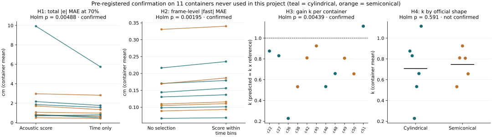

# Pre-registered confirmation on new containers

This experiment tests the hypotheses from the post-hoc
[level-by-level analysis](FAILURE_LEVELS.md) on 33 recordings from 11 new
containers.

## What was fixed in advance

Before any confirmation audio was downloaded, commit
[`b64873c`](https://github.com/lyu-ui/elec5305-project-540568813/commit/b64873c)
(10 Nov 2026, 20:46 AEDT) recorded:

- [`confirmation_protocol.json`](../experiments/confirmation_protocol.json):
  hypotheses, tests, multiplicity correction, exclusion rules and reporting;
- [`confirmation_manifest.csv`](../reference/confirmation_manifest.csv): the
  recordings, chosen from official metadata only by
  [`confirm_select.py`](../python/confirm_select.py).

The analysis script [`confirm_analysis.py`](../python/confirm_analysis.py) was
committed in `addf701` (20:53) before it was run on the confirmation data. It
was dry-run only on already-used Test II recordings, where it reproduced the
earlier numbers. It was then run once.

## Data and model

- **Recordings:** 33 official Test II recordings from 11 containers that appear
  neither in upstream training nor anywhere in this project (6 officially
  cylindrical, 5 semiconical; three recordings each, in item order). Same
  eligibility rules as the original study. All 33 were included; no exclusions.
- **Model:** the released checkpoint, run on Apple Silicon with the pinned
  inference environment. Before confirmation inference, three cached study
  recordings were recomputed: the maximum wavelength difference was 3.3e-4 cm
  against the 0.01 cm limit ([run record](../reference/confirmation_model_run.json)).
- **Frozen:** the original reliability score, the development-only retargeted
  score, features, decomposition and selection rules. Nothing was refitted.
- **Unit:** container (n = 11). Recording metrics are averaged within container.

## Results

| Hypothesis | Prediction | Estimate [95% CI] | Direction | One-sided exact p | Holm p | Outcome |
| --- | --- | --- | ---: | ---: | ---: | --- |
| H1 fill position | Time-only beats the acoustic score (total error, 70%) | −0.55 cm [−1.31, −0.12] | 10/11 | 0.0024 | 0.0049 | **Confirmed** |
| H2 frame level | Score within time bins worsens frame-level error | +0.009 cm [+0.006, +0.012] | 11/11 | 0.0005 | 0.0020 | **Confirmed** |
| H3 gain | Gain *k* below 1 | *k* − 1 = −0.28 [−0.41, −0.15] | 10/11 | 0.0015 | 0.0044 | **Confirmed** |
| H4 geometry | *k* lower for semiconical than cylindrical | +0.04 (wrong sign) | — | 0.59 | 0.59 | **Not confirmed** |



Pre-registered descriptive expectations:

| Expectation | Result | Met |
| --- | --- | --- |
| D1 offset + rate share > 50%, frame share < 10% | 82% and 9.0% | Yes (frame share close to the limit) |
| D2 retargeted score lowers frame-level error | −0.020 cm, 11/11 containers, one-sided p = 0.0005 | Yes |
| D3 taper ratio negatively related to *k* | Spearman −0.26 (n = 11) | Yes, weakly |
| D4 original score vs no selection (no direction predicted) | −0.07 cm [−0.17, +0.05], 8/11, two-sided p = 0.25 | Not significant, as on Test II |

Per-container values: [`container_metrics.csv`](../experiments/confirmation/container_metrics.csv);
per-recording: [`recording_metrics.csv`](../experiments/confirmation/recording_metrics.csv).

## Interpretation

**Confirmed on new containers.** The model under-scales the air column
(gain below 1 in 10 of 11 containers). Most error is a smooth recording-level
trend. The original reliability score works mainly by tracking fill position:
a time-only rule beats it, and inside time bins it selects worse frames. A
score aimed at frame-level error does help that level, but the level is small.

**Not confirmed: the shape explanation.** In the original 33 recordings,
semiconical containers had much lower *k* than cylindrical ones. On the new
containers, the officially cylindrical group had the slightly *lower* mean *k*.
Gain below one replicates across the new containers; the proposed association
with official shape does not.

**Post-hoc observation.** The lowest *k*
(0.23) and largest error (9.5 cm) belong to container 36, which is 25.5 cm
tall. When empty, its air column needs a quarter-wave wavelength of about
111 cm, but the model's output grid ends at 100 cm, and predictions saturate
near 98 cm. This suggests a follow-up test of container height against the
model's output range.

## Analysis conditions

- Errors use the height-and-duration linear reference defined in [Methods](METHODS.md).
- Eleven containers; the shape comparison has five and six containers.
- Official shape labels include two "cylindrical" containers with tapered radii
  (ratios 1.21 and 1.50), which may blur a shape contrast.

## Reproduce

Requires setup, `python/requirements-inference.txt` and the checkpoint:

```bash
python python/download_model.py
python python/confirm_prepare.py
python python/confirm_infer.py
python python/confirm_analysis.py
python python/verify_confirmation.py
```
