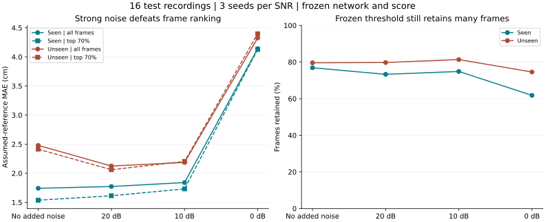
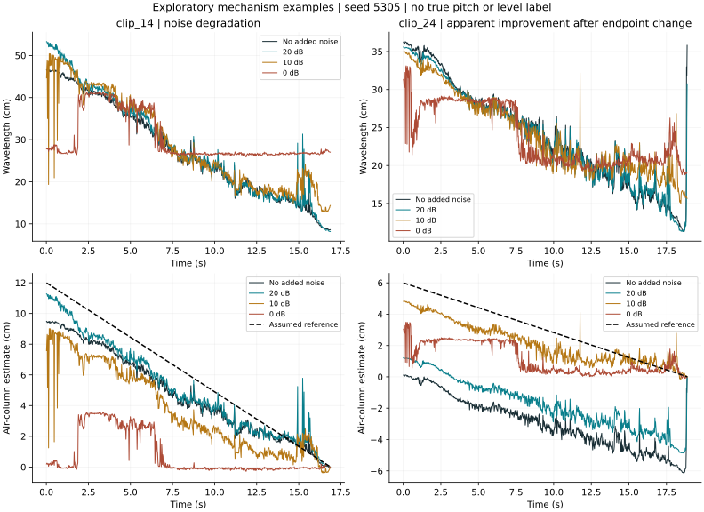
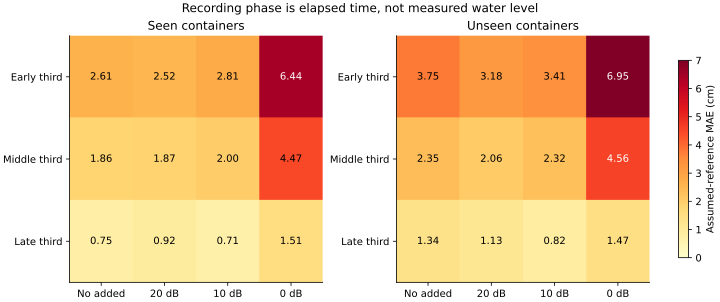
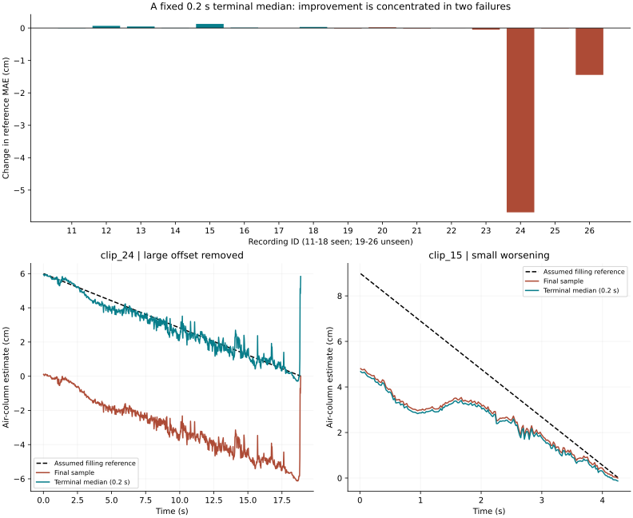
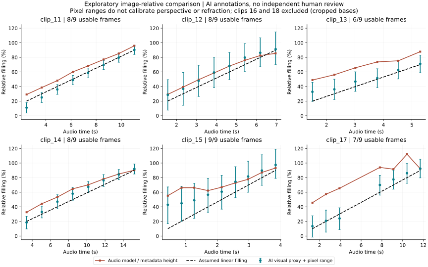

# Robustness, endpoint sensitivity and visual-reference extension

This extension adds **160 neural inference conditions** (16 no-added-noise
controls and 144 noisy conditions), an **all-33-recording endpoint comparison**,
and **72 fixed-time video inspections**. The original benchmark remains frozen.
The new evidence explains failure mechanisms and challenges overly broad
reliability claims. It does not establish independently measured liquid-level
accuracy.

## Design and provenance

[Settings](../experiments/extension_protocol.json) were written before running
the extension outcomes; this is an internal fixed protocol, not an external
preregistration. The same released checkpoint and original development-only
score are used without training, coefficient changes, or test-label tuning.
All 16 main test recordings enter the noise experiment. All 33 recordings enter
the endpoint experiment. Video screening covers all eight seen-test recordings.

The new inference environment uses PyTorch 2.14.1+cpu, Transformers 4.46.3,
NumPy 2.3.5 and SciPy 1.17.0. NumPy differs from the historical inference record.
All 215 checkpoint tensors load strictly. Recomputed clean predictions differ
from the original caches by at most **0.000222 cm in wavelength**, comfortably
below the predeclared 0.01 cm tolerance. Paired noise comparisons use recomputed
clean outputs. [Run identity](../experiments/results/noise_run.json) and
[per-recording audit](../experiments/results/clean_inference_audit.csv) preserve
the versions and hashes.

## Noise: the complete prediction pipeline

Zero-mean Gaussian noise is added at 20, 10 and 0 dB, with three fixed seeds.
The same noise realization is scaled across SNRs within a recording. SNR uses
the original recording's demeaned power; the original recording can already
contain ambient noise. Samples are not clipped. Each noisy waveform passes
through the neural predictor, acoustic features and frozen score. This differs
from the earlier Wiener controls, which did not rerun neural inference.

| Added-noise condition | Seen: all-frame reference MAE | Seen: top-70% MAE | Unseen: all-frame reference MAE | Unseen: top-70% MAE |
| --- | ---: | ---: | ---: | ---: |
| None | 1.742 cm | 1.538 cm | 2.479 cm | 2.414 cm |
| 20 dB | 1.773 cm | 1.613 cm | 2.125 cm | 2.062 cm |
| 10 dB | 1.841 cm | 1.732 cm | 2.187 cm | 2.204 cm |
| 0 dB | 4.142 cm | 4.129 cm | 4.326 cm | 4.397 cm |

Seeds are averaged within each recording, then containers receive equal weight.
Each test group has eight distinct containers. The bootstrap resamples those
containers 2,000 times; frames and repeated noise seeds are not treated as
independent sample units. All figures above measure disagreement with
`H * (1 - t / duration)`, **not true-level measurement error**.



At 0 dB, the paired change from clean is +2.399 cm for seen containers
(95% container-bootstrap interval [1.751, 3.065]) and +1.846 cm for unseen
containers ([-0.187, 3.433]). The latter interval crosses zero because the small
sample contains strong baseline failures that can improve after perturbation.
The fixed development threshold still retains **61.8% / 74.6%** of seen/unseen
frames, while reference MAE on retained frames is **4.164 / 4.399 cm**. Therefore
this threshold is not a reliable detector of noise-induced failure.

The score was fitted on the original development distribution. Strong noise
changes spectral structure and the network output; a local spectral ranking
does not necessarily identify a global physical offset. At 0 dB, top-70%
selection provides almost no seen-group benefit and worsens the unseen mean.
Gaussian noise alone does not establish robustness to speech, machinery,
reverberation, other microphones or real deployment environments.

### Why adding noise can appear to improve a result

In clip 24, 10 dB noise reduces mean assumed-reference MAE from 5.950 to
0.890 cm across seeds. Its endpoint-induced global shift is +5.147 cm,
whereas the mean absolute local wavelength contribution, `abs(delta lambda)/4`,
is only 0.409 cm. The apparent improvement is dominated by a change to an
already faulty clean endpoint. It is not evidence that noise improves true
pitch or water-level estimation. The example below uses the first fixed seed;
aggregate tables retain all three seeds and every recording.



### Early, middle and late recording phases



At 0 dB the early-third reference MAE reaches 6.440 cm (seen) and 6.947 cm
(unseen), versus 1.512 and 1.469 cm in the late third. A compressed estimate or
global offset can disagree strongly with the larger assumed early air column;
the final-sample convention also anchors the last estimate at zero. This is a
diagnostic pattern, not proof of better sensing near full capacity. These bins
are elapsed-time thirds, not independently measured physical water levels.

## Endpoint: a fixed replacement helps some failures and hurts others

The baseline subtracts the last predicted wavelength. The primary alternative
subtracts the median of samples within 0.2 s of the final prediction timestamp.
Sensitivity windows are 0.1 and 0.5 s. Windows are fixed globally; none is tuned
per recording, and predictions are not clipped to a plausible range.

For wavelength estimates `lambda(t)` and endpoint `e`, the physical decoder is
`L(t) = (lambda(t) - e) / 4`. Changing the endpoint produces the same shift at
every time: `delta L = (old endpoint - new endpoint) / 4`.

| Test group | Last-sample MAE | 0.2 s median MAE | Paired change [95% interval] | Improved / worsened / unchanged |
| --- | ---: | ---: | --- | --- |
| Seen, 8 recordings | 1.742 cm | 1.778 cm | +0.036 [0.009, 0.066] cm | 1 / 6 / 1 |
| Unseen, 8 recordings | 2.482 cm | 1.583 cm | -0.899 [-2.318, -0.005] cm | 6 / 2 / 0 |

Endpoint analysis uses **all cached prediction frames**. Noise/score analysis
uses only prediction frames covered by the STFT. That denominator difference
explains 2.482 versus 2.479 cm for the unseen baseline; the historical result
has not been replaced. Development summaries average recordings within each
container first, because one development container occurs twice.



The improvement is concentrated in clips 24 and 26, whose MAE changes are
-5.686 and -1.446 cm. For the other six unseen recordings, the mean change is
only -0.010 cm (a post-hoc descriptive check, not a new primary endpoint).
A median suppresses an isolated final switch, but a monotonically falling
wavelength makes a preceding window larger than the true terminal value.
Subtracting it can move the whole trajectory downward and worsen a previously
reasonable result. Clip 15 worsens by 0.128 cm. A median corrects the offset;
it does **not** remove individual wavelength spikes, including a remaining
spike at the final frame of clip 24.

The unseen mean MAE is 1.918, 1.583 and 1.682 cm for the 0.1, 0.2 and 0.5 s
windows; seen values are 1.750, 1.778 and 1.821 cm. This small existing test set
does not justify adopting whichever window happens to win as universally best.
The original default decoder remains unchanged.

## Visual reference without a ruler

Nine timestamps at 10%-90% of audio duration were selected for each of the eight
paired videos before comparing visual coordinates with predictions. Source
video hashes, actual decoded frame timestamps and nearest-frame offsets are
recorded. Audio cross-correlation verifies the paired video/WAV identity:
all eight lag estimates are zero samples and correlations exceed 0.9997.

An AI assistant inspected the video frames and coordinate grids without
displaying prediction curves. Earlier aggregate project results were known;
this is not a fully blinded independent-human study. The
[annotation file](../experiments/visual_annotations.json) was frozen before
the visual comparison script ran. It records visible rim, internal-base and
water-surface ranges, with an explicit reason for every exclusion.

| Clip | Provisional usable / planned | Main visibility issue |
| --- | ---: | --- |
| 11 | 8 / 9 | Early condensation and base ambiguity |
| 12 | 8 / 9 | Early bubbles/reflections; low vertical resolution |
| 13 | 6 / 9 | Early bubbles; late decorative bands |
| 14 | 8 / 9 | Early surface merges with thick glass base |
| 15 | 9 / 9 | Wide bounds for taper, refraction and near/far surface separation |
| 16 | 0 / 9 | Cup base is outside the frame |
| 17 | 7 / 9 | Sticker hides two middle samples |
| 18 | 0 / 9 | Full cup base is cropped by the lower image boundary |
| Total | **46 / 72** | **46 green water bands confirmed by the author; 26 exclusions retained** |

The project author subsequently inspected the private nine-page review PDF and
explicitly confirmed all displayed green water-surface bands, with no corrections.
The [human-review record](../experiments/visual_human_review.json) identifies all
46 confirmed frames and binds them to the frozen annotation SHA-256 and reviewed
PDF SHA-256. The original annotation file, including its historical
`not_reviewed` field, is preserved byte-for-byte; the separate review record is
the subsequent status update. Per-frame results now distinguish the 46
`author_confirmed_water_band` entries from 26 excluded `not_reviewed` entries.
The `ai_provisional` inclusion status continues to describe AI origin and
uncalibrated proxy measurements, not a lack of water-band confirmation.

This is a single project-author confirmation after exploratory results were
available, not independent blinded re-annotation or inter-rater reliability.
Confirmation covers green water-surface bands only: blue rim/base bands and
exclusion decisions were not separately certified. All coordinates, exclusions
and numerical comparison results remain unchanged.

The image-relative proxy is `(base_y - surface_y) / (base_y - rim_y)`.
All endpoint combinations of the declared pixel ranges are evaluated.
These ranges are **annotation sensitivity bounds**, not statistical confidence
intervals. They do not correct perspective, refraction, container taper or the
mapping between metadata height and visible internal height. No primary
centimetre conversion or centimetre-accuracy claim is made. Values/ranges are
not clipped to [0,1], so uncertainty beyond the rim remains visible.



Across the six usable recordings, equal-recording mean absolute difference
from the visual midpoint is **11.59 percentage points** for the audio model
and **6.91 points** for the assumed linear filling fraction. These are exploratory
image-proxy discrepancies, not physical accuracy scores. Spearman agreement
between model and visual midpoints ranges from 0.821 to 1.000. Strong trend
agreement can coexist with substantial offsets: clip 17 has a 24.92-point
midpoint discrepancy and some model fractions above 100%.

Clip 15's assumed filling fraction differs from the visual midpoint by
16.36 points on average, with wide pixel bounds. This flags the assumed
reference itself for scrutiny; it cannot isolate flow, geometry and projection
effects. The low/middle/high visual-midpoint table is descriptive, retains
boundary ambiguity, and does not count frames as independent test samples.

This extension adds a visual modality to existing seen-test examples. It adds
neither new unseen containers nor calibrated measured labels. The 46 green
water-surface bands now have author confirmation. Independent blinded validation,
separate rim/base review and calibrated physical-level validation remain open.

## Reproduce and audit

From the repository root:

```bash
python -m pip install -r python/requirements-extension.txt
python python/setup_project.py --data-only
python python/download_model.py
python python/run_extension.py --endpoint --noise
python python/prepare_visual_reference.py
python python/evaluate_visual_reference.py
python python/plot_extension.py
python python/verify_extension.py
```

Video extraction additionally needs `ffmpeg` and `ffprobe`. Raw media, model
weights and per-condition prediction caches remain local. Noise runs resume
from `outputs/extension_noise`; remove that directory after changing inference
or noise-generation code. Reuse the committed annotation version when
reproducing published visual numbers; revised human labels require a new,
explicitly identified annotation version and comparison.

`python python/make_visual_review_pdf.py` optionally creates private review
sheets with ReportLab and Pillow. The sheets display confirmation counts from
the hash-bound human-review record; they are a review aid, not a course report.
Use `python python/plot_extension.py --visual-only` to refresh only the visual
figure after a review-status update.

The [result directory](../experiments/results/) contains per-clip, per-seed,
phase, endpoint and visual tables. `verify_extension.py` checks trial completeness,
frozen identities, SNRs, summary aggregation and all 72 inclusion/exclusion
decisions without requiring a model download. The original MATLAB outputs
remain historical evidence; these extension experiments ran in Python.
