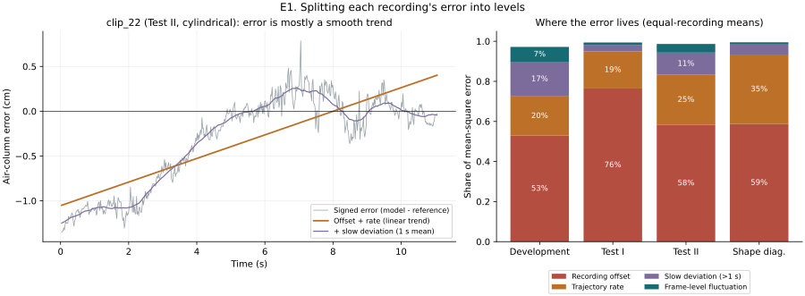
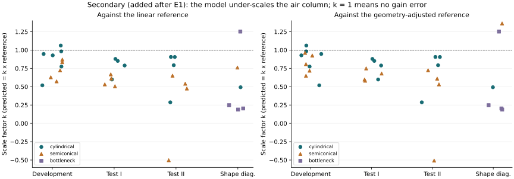
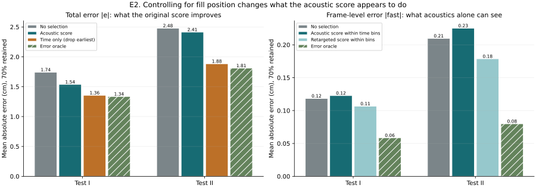
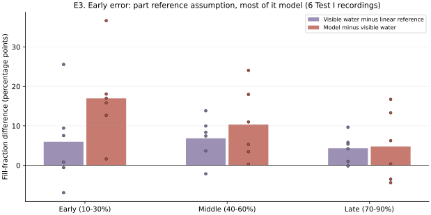
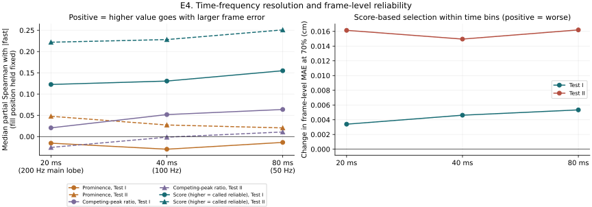

# What makes the estimate work and fail, level by level

Instructor feedback (5 Nov 2026) asked for more tests to understand what makes
things work and fail at different levels. This analysis asks *where* the
air-column error comes from and *which* signal can see it. It uses the existing
33 recordings, cached model outputs and 46 author-confirmed video labels. No new
labels are created.

**Status and honesty.** On 10 Nov a quick exploratory check showed that error
falls strongly with fill progress and that a time-only rule beat the acoustic
score. The definitions, metrics and four primary comparisons below were then
fixed in [`failure_levels_protocol.json`](../experiments/failure_levels_protocol.json)
before the full tables were computed. This is therefore a post-hoc explanatory
study, not independent confirmation. One analysis (the scale factor *k*) was
added after E1 and is labelled as such. All errors remain relative to the
assumption-derived filling reference.

Code: [`python/failure_levels.py`](../python/failure_levels.py) ·
Tables and figures: [`experiments/failure_levels/`](../experiments/failure_levels/)

## Summary of levels

| Level | What decides success or failure | Key evidence |
| --- | --- | --- |
| Container geometry | The model under-scales the air column; much more for tapered and bottleneck vessels | Median *k*: cylindrical 0.82–0.94, semiconical 0.51–0.72, bottleneck 0.23 |
| Recording | A smooth offset-plus-rate trend carries most error | 95% (Test I) and 83% (Test II) of mean-square error |
| Fill position | Gain error anchored at full makes early frames worst in centimetres | Dropping the earliest 30% beats the acoustic score, 8/8 recordings in both groups |
| Frame | Fast fluctuations are a small share; spectral-peak features do not track them | 1–4% of mean-square error in Test I/II; partial Spearman about 0 |
| Reference | The linear reference also lags the visible water, but less than the model | Early: water +6 pp above reference, model +17 pp above water |

## E1. Splitting each recording's error into levels

For every recording the signed error *e* = predicted − reference air-column
length is split into a recording offset, a linear trend in fill position
(trajectory rate), a slow deviation (1 s moving mean of the remainder) and a
frame-level fluctuation. Mean-square shares sum to one with the reported
slow/fast cross term.

| Group | Recordings | Offset | Rate | Slow | Frame | MAE (cm) |
| --- | ---: | ---: | ---: | ---: | ---: | ---: |
| Development | 11 | 53% | 20% | 17% | 7% | 1.34 |
| Test I (7/8 development containers) | 8 | 76% | 19% | 3% | 1% | 1.74 |
| Test II (new containers) | 8 | 58% | 25% | 11% | 4% | 2.48 |
| Shape diagnostics | 6 | 59% | 35% | 5% | 1% | 6.46 |



**Interpretation.** Almost all error is a smooth, recording-wide trend. A method
that keeps or rejects individual frames can at most act on a few percent of the
mean-square error unless it effectively selects by position in the pour.

### Secondary (added after E1): a gain error, set by geometry

The released endpoint correction forces prediction and reference to zero at the
final frame. A pure gain error, predicted = *k* × reference, then appears as
offset plus rate. Fitting *k* per recording explains a median 93–95% of Test I
and 71–84% of Test II mean-square error.

| Group | Shape | Median *k* (linear ref.) | Median *k* (geometry-adjusted ref.) |
| --- | --- | ---: | ---: |
| Test I | cylindrical | 0.82 | 0.82 |
| Test I | semiconical | 0.57 | 0.64 |
| Test II | cylindrical | 0.85 | 0.85 |
| Test II | semiconical | 0.51 | 0.57 |
| Shape diagnostics | bottleneck | 0.23 | 0.23 |



The geometry-adjusted (constant-volume frustum) reference raises semiconical *k*
only slightly, so most of the shape gap is not a reference artefact. The
model's quarter-wave conversion of wavelength to air-column length behaves like
a cylinder; tapered and bottleneck air columns resonate differently, so the
same wavelength change maps to too little length change. Radius, height and
their ratio showed no clear relation to *k* (|Spearman| < 0.1 across the 27
development and test recordings). The one negative *k* (Test II) is the clip 24 endpoint failure.

## E2. What the acoustic score actually predicts

Methods keep 70% of frames in each recording. *Time-stratified* selection keeps
the top 70% by score inside each of ten equal-duration bins, so it cannot
select by fill position. *Frame-level* error is |fast| from E1.

| Primary comparison (70%) | Test I | Test II |
| --- | --- | --- |
| Time only − acoustic score, total error | −0.18 cm [−0.30, −0.09], 8/8 better | −0.53 cm [−1.04, −0.16], 8/8 better |
| Score within time bins − no selection, frame error | +0.004 cm [+0.003, +0.006], 8/8 worse | +0.016 cm [+0.009, +0.022], 8/8 worse |

Every primary comparison has exact sign-flip p = 0.0078 (2/256) and Holm-adjusted
p = 0.031. Intervals are 2,000 container bootstrap resamples.



Within-recording partial Spearman correlations with frame-level error, holding
fill position fixed (median over 8 recordings):

| Variable | Test I | Test II |
| --- | ---: | ---: |
| Prominence | −0.03 | +0.03 |
| Competing-peak ratio | +0.05 | 0.00 |
| Spectral entropy | +0.03 | −0.01 |
| Model-frequency support | 0.00 | −0.05 |
| Model pitch jump (log cents) | +0.20 (8/8 positive) | +0.24 (8/8 positive) |
| Frozen reliability score | +0.13 (8/8 positive) | +0.22 (8/8 positive) |

**Interpretation.**

- The original score's benefit comes from fill position, not from frame-level
  acoustic evidence. Prominence and model support rise late in the pour, when
  centimetre errors are small, so they look predictive overall but carry almost
  no frame-level information.
- The score gives large pitch jumps a *reliable* direction (negative coefficient
  on predicted error). Jumps cluster late in the pour, so the confound flips the
  sign of the one cue that does track frame-level error. Inside time bins the
  score therefore picks worse frames.
- A secondary, development-only score retargeted to frame-level error reduces
  it in 8/8 recordings in both groups (Test I 0.118 → 0.107 cm, Test II 0.210 →
  0.179 cm). This mostly uses the pitch-jump cue, which is a model-consistency
  signal rather than independent spectral evidence. Because frame-level error
  is a small share, total error barely changes.

## E3. Reference assumption or model?

The 46 author-confirmed water-band labels (6 Test I recordings) compare visible
filling with the linear reference and the model.

| Pour phase | Labels | Visible water − reference | Model − visible water | Model outside visual interval |
| --- | ---: | ---: | ---: | ---: |
| Early (10–30%) | 14 | +6.0 pp (4/6 positive) | +17.0 pp (6/6 positive) | 9/14 |
| Middle (40–60%) | 16 | +6.8 pp (5/6) | +10.3 pp (6/6) | 7/16 |
| Late (70–90%) | 16 | +4.3 pp (5/6) | +4.8 pp (4/6) | 4/16 |



**Interpretation.** Water rises somewhat faster than the linear reference, so
part of the early disagreement is a reference error. The larger part is the
model reporting even more water than is visible, shrinking towards the end of
the pour, which matches the gain error above. This is descriptive: six
recordings, image-relative proxies, perspective and refraction uncertainty.

## E4. STFT window length

Features were recomputed with 20, 40 and 80 ms Hann windows (main lobes 200,
100 and 50 Hz) on a common frame grid, and the score was refitted on development
data for each window.



Spectral-peak features stay near zero partial correlation with frame-level
error at every window. Score-based selection inside time bins makes frame error
worse at all three windows (Test I +0.003 to +0.005 cm, Test II +0.015 to
+0.016 cm). Changing the time-frequency trade-off does not fix the problem,
which supports the E1/E2 conclusion that the limiting factor is the error
structure, not spectral resolution.

## Consequences for the project's claims

- The original Test I improvement at 70% retention is reproducible, but its
  mechanism is mainly fill position. A time-only rule is better in both groups.
- Reliability is decided mainly at the geometry and recording levels. Useful
  next steps are shape-aware conversion from wavelength to air-column length
  and recording-level checks (gain and endpoint), not finer frame selection.
- Frame-level reliability is learnable from model-consistency cues, but it
  matters little for total error here.

## Limitations

- Post-hoc analysis motivated by disclosed exploration; four primary
  comparisons were fixed before computing the tables.
- Reference-relative error throughout. Video labels are provisional,
  image-relative and cover 6 Test I recordings only.
- Eight recordings per test group; exact tests use the sign-symmetric null.
- |fast| depends on the 1 s smoothing choice; pitch jumps feed the predicted
  trajectory directly, so their link to |fast| is partly mechanical.
- The scale-factor analysis was added after E1 and is descriptive.

## Reproduce

After setup:

```bash
python python/failure_levels.py
python python/verify_failure_levels.py
```
