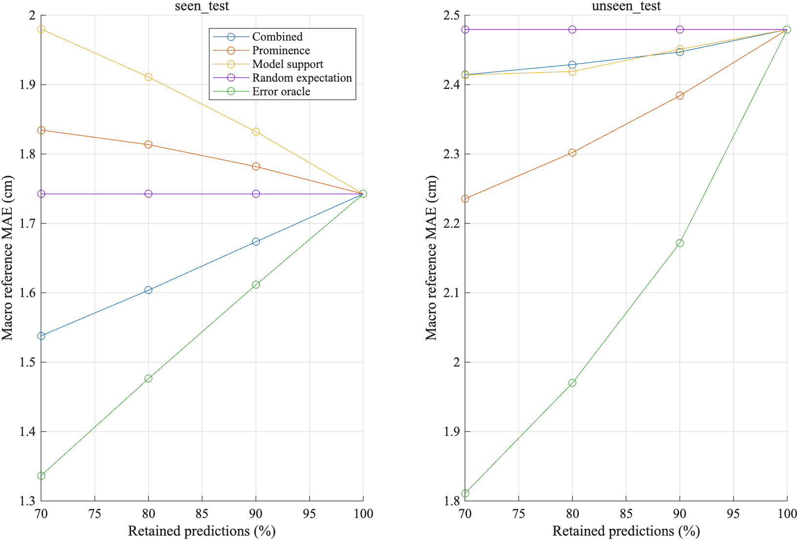
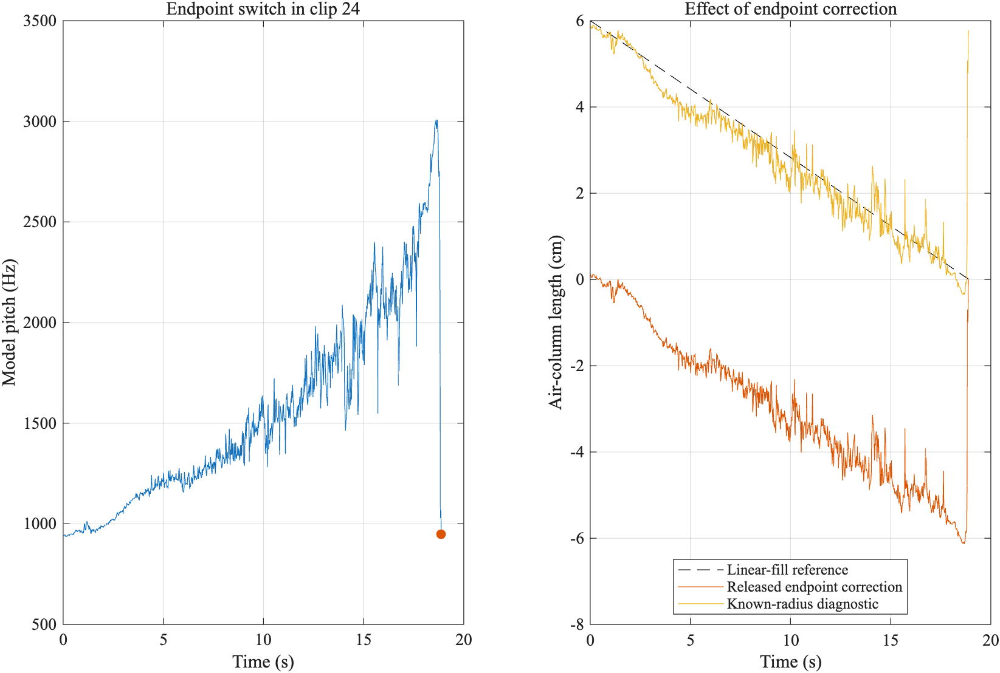
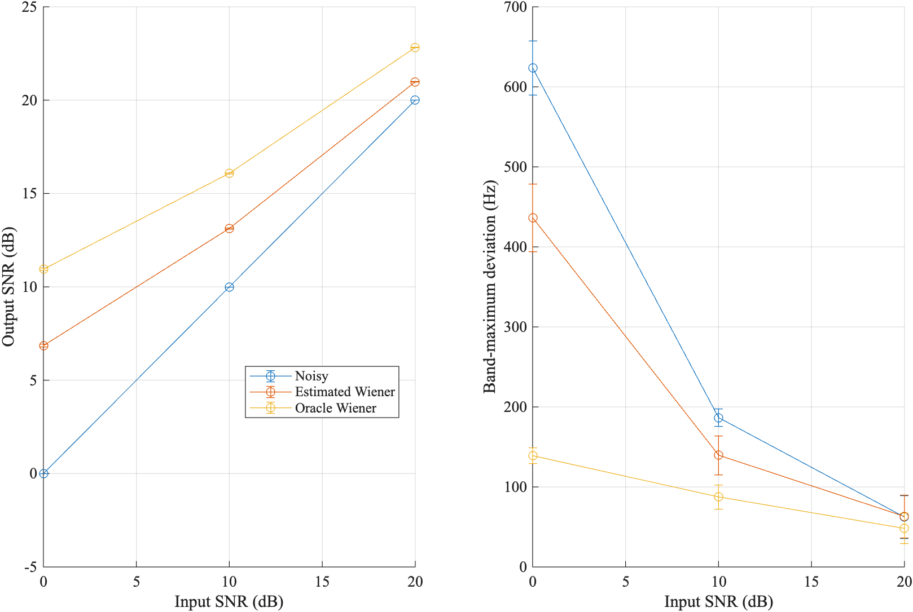

# Results and interpretation

## Selective prediction

| Retained frames | Seen macro reference MAE (cm) | Unseen macro reference MAE (cm) |
| --- | ---: | ---: |
| 100% | 1.742 | 2.479 |
| 90% | 1.673 | 2.447 |
| 80% | 1.604 | 2.447 |
| 70% | 1.538 | 2.414 |

The seen-group reduction at 70% retention is about 11.7%. The unseen-group
reduction is about 2.6%, with a paired 95% interval spanning zero. On unseen
recordings, prominence alone gives 2.235 cm at 70% retention, outperforming
the combined score. The fitted model therefore does not establish a universal
reliability rule.

The separate development-fitted threshold produces approximately 76.9% seen
and 79.6% unseen coverage, illustrating that a training retention target does
not guarantee the same coverage on new recordings.

## Endpoint failure

Clip 24 has a final model frequency far below its preceding ridge. Because
the released calculation subtracts the final wavelength from every frame,
the isolated switch introduces a global offset. Its primary reference MAE
is 5.950 cm. Substituting the metadata radius for diagnosis gives 0.294 cm.
That diagnostic uses extra geometry information and is not a validated
unknown-container prediction method.

The same intervention worsens clip 22 (0.431 to 0.806 cm) and helps clip 18
(1.800 to 1.439 cm). This supports a case-specific mechanism, not a universal
replacement rule. See `results/endpoint_diagnostic.csv`.

## Geometry and acoustic ambiguity

Semiconical reference error is sensitive to the assumed filling law. The
mean changes from 2.115 to 1.450 cm in seen semiconical recordings and from
3.591 to 2.887 cm in unseen semiconical recordings when the geometry-adjusted
reference is used. Predictions are unchanged. Bottleneck examples show
competing branches and motivate a different physical model; their
cylinder-reference errors are diagnostic only.

## Noise removal and listening

| Input SNR | Estimated output SNR | Oracle output SNR |
| --- | ---: | ---: |
| 0 dB | 6.85 dB | 10.94 dB |
| 10 dB | 13.13 dB | 16.08 dB |
| 20 dB | 20.98 dB | 22.82 dB |

Values average three noise realizations. Better SNR does not always mean
better spectral preservation: at 20 dB, the estimated mask slightly worsens
mean band-maximum deviation, from approximately 62.3 to 63.1 Hz.

The author listened to the original, noisy, estimated-Wiener and oracle-Wiener
signals at 10 dB using shared gain and noise realization 1. The noisy version
had obvious noise; the estimated-Wiener version retained clear water sound
and was not obviously different from the original; the oracle sounded
intermittent. These are one listener's informal observations, not blinded
ratings or evidence of zero distortion.

## LPC and pooling controls

All fitted control poles remain inside the unit circle. Increasing order
does not monotonically improve the two resonance estimates. For the real
frame, a strong LPC peak is not by itself proof of the physical fundamental.

The ERB-spaced pooling control weakens the valley between two nearby tones.
This explains the choice to retain a narrowband representation when
diagnosing competing peaks.

## What the results establish

Acoustic features help reject some high-reference-error frames, especially
on the selected seen-container subset. Endpoint correction and physical
model mismatch can still defeat local spectral evidence. Independent
level measurements and additional unseen containers are required before
claiming deployment accuracy.
