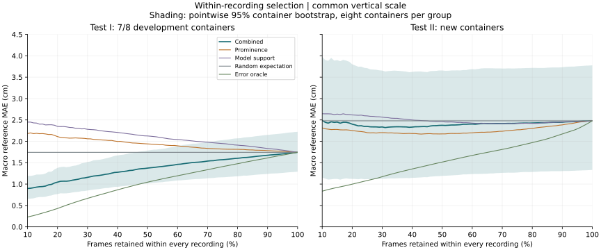
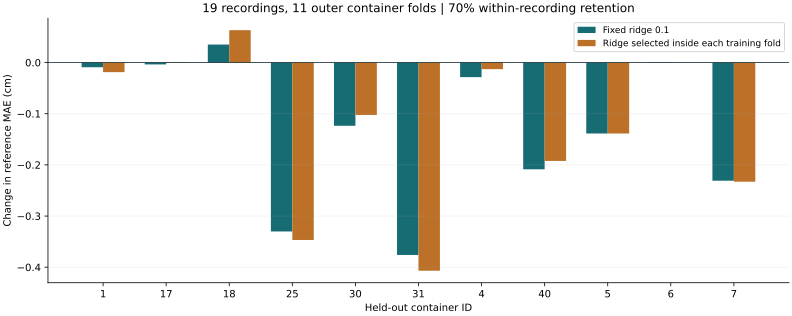
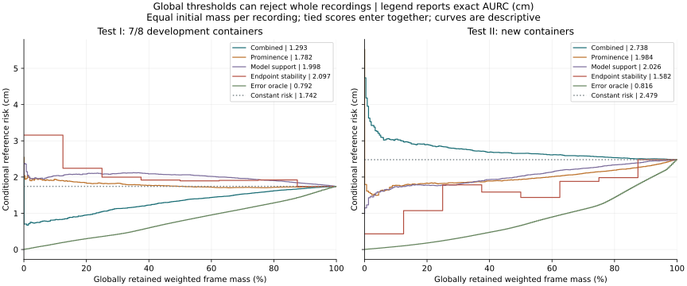

# Container overlap and statistical audit

This revision corrects the interpretation of the original Test I result and
adds exploratory analyses requested after the original results were known.
It preserves the original score, selected recordings and benchmark tables.
The [audit protocol](../experiments/statistical_audit_protocol.json) records the
choices; it is not an external preregistration or a newly collected test set.

## Two different meanings of an unseen container

The released neural model and this project's reliability regression have
different training sets. Official Test I means containers seen by the upstream
neural model. Seven of the eight selected Test I containers also appear in the
development data used to fit the reliability regression:

| Test recording | Container | In reliability-score development? |
| --- | --- | --- |
| clip_11 | container_1 | Yes |
| clip_12 | container_6 | Yes |
| clip_13 | container_7 | Yes |
| clip_14 | container_18 | Yes |
| clip_15 | container_25 | Yes |
| clip_16 | container_30 | Yes |
| clip_17 | container_31 | Yes |
| clip_18 | container_40 | No |

The recordings/videos themselves are distinct. Thus the original Test I
comparison is a **recording-held-out test with 7/8 development containers**,
not a container-disjoint generalisation test. Calling all eight a homogeneous
"development-container test" would hide the clip_18 exception. The original
machine-readable role `seen_test` is retained for reproducibility and is always
interpreted here with the overlap qualifier. Test II's eight containers are
absent from both reliability-score development and upstream training.

Overlap is a plausible contributor to the difference between groups, not an
isolated causal explanation: opacity, shape, material and other conditions
also differ. The [split audit](../experiments/statistical_audit/split_audit.csv)
records overlap for every recording.

## Exact paired tests and small-sample uncertainty

For each method/group, subtract full-recording MAE from MAE at 70% retention,
giving eight container differences. The two-sided statistic is the absolute
mean difference. Enumerate all 256 sign assignments and include ties at least
as extreme as the observed statistic. Exactness is conditional on joint sign
symmetry/exchangeability under the null; it is not a distribution-free cure
for the small sample. These are post-review exploratory tests.

| Group | Method | Full / retained MAE (cm) | Change (cm), 95% bootstrap interval | Improved | Exact p | Holm p |
| --- | --- | --- | --- | ---: | ---: | ---: |
| Test I: 7/8 development containers | Combined | 1.742 / 1.538 | -0.204 [-0.274, -0.134] | 8/8 | 0.0078125 | 0.03125 |
| Test I: 7/8 development containers | Prominence | 1.742 / 1.834 | +0.092 [+0.040, +0.143] | 1/8 | 0.015625 | 0.046875 |
| Test II: new containers | Combined | 2.479 / 2.414 | -0.065 [-0.158, +0.031] | 7/8 | 0.2578125 | 0.515625 |
| Test II: new containers | Prominence | 2.479 / 2.235 | -0.244 [-0.588, +0.016] | 5/8 | 0.4453125 | 0.515625 |

Holm adjustment covers these four comparisons. The original Combined
percentile bootstrap intervals are retained unchanged. Prominence uses 2,000
container resamples, seed 5305. Eight clusters give unstable percentile
intervals; frame count does not increase the independent sample size.

Prominence's lower Test II mean is driven largely by clip_20 (-1.347 cm) and
clip_23 (-0.673 cm), while seven Test I recordings worsen. Its effect changes
direction between groups and is unstable. A lower observed mean does not
establish superiority. The displayed tests compare each method with no
selection; they do not test Prominence against Combined directly.



The updated plot uses 91 retention fractions, common vertical limits and
pointwise Combined-score container-bootstrap shading. The shading is not a
simultaneous confidence band and does not replace the paired tests above.

## Container-disjoint evaluation and ridge selection

Pool development and Test I: 19 recordings from 11 containers. In each outer
fold, withhold every recording from one container. Refit standardisation and
the regression only on the other ten containers. The neural predictor remains
frozen; this removes container overlap for the reliability regression, not
for the upstream pretrained network.

Report both the original fixed ridge penalty 0.1 and nested selection from
0.001, 0.01, 0.1, 1, 10 and 100. Each candidate is assessed by inner
leave-one-container-out validation using only outer-training containers.
The objective averages squared log1p-error prediction loss within recordings,
then within containers, then across validation containers. Every training
fit uses the original equal-recording weights. Standardisation is refitted
inside every inner fold. No outer-test error chooses a penalty.

| Model | Full MAE (cm) | MAE at 70% (cm) | Change (cm) | Improving containers |
| --- | ---: | ---: | ---: | ---: |
| Fixed ridge 0.1 | 1.457 | 1.329 | -0.129 | 9/11 |
| Nested ridge selection | 1.457 | 1.331 | -0.126 | 9/11 |

First average recordings within an outer container, then average the eleven
containers. These values therefore use a different pool and weighting from
the original eight-recording Test I result. Selected penalties range from
0.001 to 100; tuning does not improve the pooled mean here. The fixed 0.1 was
a baseline regularisation choice on standardised features, not an established
optimum. It remains the historical score used on Test II.



This is a useful container-disjoint check within the original development/Test I
domain. It is post-review analysis and does not erase Test II's inconclusive
finding. Outer fits share training data, so no independent-fold significance
claim is made. Fold identities, inner losses and per-recording results are
published alongside the [summary](../experiments/statistical_audit/loco_summary.csv).

## Global thresholds and whole-recording failures

Within-recording ranking must keep 70% of every recording. It cannot abstain
from an entire globally offset trajectory such as clip_24. The new global
curve applies one score threshold across all test recordings in a group.
Each recording receives equal initial weight; each of its frames receives
that weight divided by its frame count. Coverage is retained weight, and
conditional risk is retained weighted error divided by retained weight.
This estimand differs from averaging surviving-recording MAEs.

All distinct score thresholds are evaluated, and tied scores enter together.
AURC is the exact right-step sum over coverage increments on (0,1]; smaller is
better. There is no invented zero-risk origin. The exported figure/CSV uses at
most 201 display points per curve, while AURC uses every threshold before
thinning. A constant-risk reference line has area equal to full risk; it is
not asserted as an exact finite-sample random-permutation AURC.

| Group | Combined AURC | Prominence AURC | Endpoint-stability AURC | Constant-risk area |
| --- | ---: | ---: | ---: | ---: |
| Test I: 7/8 development containers | 1.293 | 1.782 | 2.097 | 1.742 |
| Test II: new containers | 2.738 | 1.984 | 1.582 | 2.479 |

Units are cm against the assumed reference. These retrospective curve
summaries are descriptive; they do not establish superiority or select a
deployment threshold. In particular, the Combined global score has higher
Test II AURC than the constant-risk reference despite its small improvement
under within-recording ranking. Cross-recording score calibration is weak.



For an explicitly development-only threshold grid, 101 quantiles of
development Combined scores are fixed and then applied unchanged to both
test groups. The [grid table](../experiments/statistical_audit/development_threshold_grid.csv)
reports actual coverage, risk and the number of recordings represented.
No operating point is chosen using test errors.

The recording-level indicator is the absolute pitch difference in cents
between the last prediction and the median of preceding predictions in the
last 0.2 seconds, excluding the last prediction. A flag threshold of
114.67 cents is the development recordings' 90th percentile. It flags
clip_24 (1,834.16 cents) and clip_26 (1,168.04 cents), and no Test I recording.
Ranking recordings by the negative indicator produces the endpoint-stability
curve. Its Test I AURC is worse, so this diagnostic is not a universal
reliability score. It is offline and can miss errors unrelated to endpoint
instability. The threshold itself is estimated from only eleven recordings.

## Reproduction

```bash
python python/setup_project.py --data-only
python python/audit_statistics.py
python python/plot_statistical_audit.py
python python/verify_statistical_audit.py
```

The first two commands require the source audio locally; no neural inference
or new model weights are needed. The verifier checks saved results and fold
identities without downloading media. Historical `results/`, `reference/`
and earlier experimental results are preserved.
